# CATÁLOGO DE ACTORES Y CASOS DE USO (ICONIX)
### FashionStore — Plataforma SaaS Multitenant E-Commerce
**Metodología:** ICONIX Process (UML 2.5+)  
**Alcance:** 28 Casos de Uso Oficiales (12 Modificados del 1er Parcial + 16 Nuevos del 2do Parcial)

---

## 1. Clasificación Oficial de Actores del Sistema

El modelado ICONIX define a los actores como entidades externas que interactúan con las fronteras del sistema, categorizándolos en **Actores Principales (Humanos)** y **Actores Secundarios / del Sistema (Recursos Externos y Procesos)**:

### 1.1. Actores Principales (Usuarios del Sistema)

| Actor | Rol y Responsabilidad en el Negocio | Plataforma |
| :--- | :--- | :--- |
| **Superadministrador (`Superadmin`)** | Administrador global de la plataforma SaaS. Registra empresas (*tenants*), gestiona planes de suscripción (Básico y Profesional), asigna cuotas de sucursales y supervisa métricas globales de la infraestructura. | Web (Portal Master) |
| **Administrador de Tienda (`Tenant Admin`)** | Propietario o gerente general de la empresa tenant. Configura los datos de su empresa, crea sucursales físicas dentro de los límites de su plan, administra el catálogo global de prendas con sus variantes de precio y talla, define políticas de cambio/devolución y consulta reportes analíticos con IA. | Web (Panel de Administración) |
| **Encargado de Sucursal (`Branch Manager`)** | Responsable operativo de una tienda física particular. Gestiona el inventario de su sucursal, autoriza traslados de mercadería, resuelve reservas de prendas expiradas y supervisa arqueos de caja y ventas locales. | Web / Móvil (App Gerencial) |
| **Cajero / Vendedor (`Cashier`)** | Personal de punto de venta físico en sucursal. Opera el POS en modo online o en contingencia desconectada (**offline**), efectúa cobros en efectivo, gestiona la bandeja de sincronización, ejecuta cambios de prenda cobrando la diferencia de talla y procesa devoluciones con retención del 20%-50%. | Web (PWA POS) / Móvil POS |
| **Cliente (`Customer`)** | Usuario final comprador. Navega por el catálogo online o en caché offline, filtra prendas por talla y precio, realiza compras digitales con tarjeta mediante Stripe, genera reservas de stock en sucursales, visualiza rutas en OpenStreetMap y utiliza el probador virtual en Realidad Aumentada (AR). | Web (Tienda Online) / Móvil (App Cliente) |

---

### 1.2. Actores Secundarios / del Sistema (Recursos y Servicios Externos)

| Actor | Naturaleza | Función en el Sistema |
| :--- | :--- | :--- |
| **Backend API (`Backend API`)** | Servidor Central | Ejecuta las reglas de negocio, forzado de aislamiento multitenant por `tenant_id`, cálculo de diferencias de precio, verificación de idempotencia y persistencia en PostgreSQL. |
| **Motor de Sincronización (`Sync Engine`)** | Proceso Background | Tarea asíncrona en cliente (PWA Service Worker / Mobile Background Task) que detecta la recuperación de conectividad a Internet y despacha lotes de ventas pendientes (`PENDIENTE_SYNC`) hacia el backend. |
| **Pasarela de Pagos Stripe (`Stripe Gateway`)** | Servicio Externo | Procesa cobros con tarjeta de crédito/débito en tiempo real, tokeniza credenciales financieras y notifica la confirmación definitiva (`paid`) mediante webhooks criptográficos para habilitar el despacho de mercadería. |
| **Servicio de Mapas y Rutas (`OpenStreetMap / ORS`)** | API Externa | Provee teselas de mapas abiertas para renderizado en Flutter y resuelve el trazado de rutas de navegación física (a pie o vehículo) desde la posición del cliente hacia la sucursal más cercana. |
| **Módulo de Inteligencia Artificial (`AI & ML Service`)** | Motor Analítico | Procesa audio y texto mediante la API de Google Gemini para responder consultas ejecutivas por voz, y ejecuta algoritmos Scikit-Learn (Supervisado de demanda y No Supervisado K-Means) sobre datasets sintéticos. |

---

## 2. Matriz de Trazabilidad: Casos de Uso vs Requisitos Funcionales

| Paquete | Código | Nombre del Caso de Uso | Tipo | Requisitos Funcionales Abarcados |
| :--- | :--- | :--- | :--- | :--- |
| **P1** | **CU01** | Registrar y Gestionar Empresas (Tenants) | Modificado 1P | RF-01 (Registro empresa), RF-02 (Aislamiento datos) |
| **P1** | **CU02** | Gestionar Planes de Suscripción y Límites | Nuevo 2P | RF-03 (Planes Básico/Pro), RF-04 (Límites sucursales) |
| **P1** | **CU03** | Iniciar Sesión Multitenant con JWT | Modificado 1P | RF-05 (Autenticación JWT), RF-06 (Claims tenant y rol) |
| **P1** | **CU04** | Gestionar Sucursales Bajo Límites del Plan | Modificado 1P | RF-07 (CRUD Sucursales), RF-08 (Validación límite plan) |
| **P1** | **CU05** | Gestionar Perfil y Preferencias de Usuario | Modificado 1P | RF-09 (Edición perfil), RF-10 (Seguridad cuenta) |
| **P2** | **CU06** | Gestionar Prendas y Variantes de Precio/Talla | Modificado 1P | RF-11 (CRUD Prendas), RF-12 (Variantes talla/precio) |
| **P2** | **CU07** | Consultar Catálogo Online con Búsqueda Facetada | Modificado 1P | RF-13 (Filtro categorías), RF-14 (Filtro precio/tallas) |
| **P3** | **CU08** | Descargar Catálogo a Base Local (IndexedDB/SQLite)| Nuevo 2P | RF-15 (Descarga offline), RF-16 (Almacenamiento local) |
| **P3** | **CU09** | Consultar Catálogo Offline en Modo Desconectado | Nuevo 2P | RF-17 (Renderizado sin red), RF-18 (Caché local) |
| **P3** | **CU10** | Consultar Disponibilidad de Stock por Sucursal | Modificado 1P | RF-19 (Inventario multisede), RF-20 (Stock por talla) |
| **P3** | **CU11** | Registrar y Autorizar Traslados de Mercadería | Modificado 1P | RF-21 (Movimientos entre tiendas), RF-22 (Auditoría) |
| **P4** | **CU12** | Comprar Prendas con Stripe y Despacho Condicionado| Modificado 1P | RF-23 (Carrito compras), RF-24 (Cobro Stripe/Despacho) |
| **P4** | **CU13** | Crear Reserva de Prendas con Vencimiento | Nuevo 2P | RF-25 (Apartado stock), RF-26 (Temporizador reserva) |
| **P4** | **CU14** | Atender y Resolver Conflictos de Reservas | Nuevo 2P | RF-27 (Liberación automática), RF-28 (Consolidación) |
| **P5** | **CU15** | Registrar Venta Directa en POS Online | Modificado 1P | RF-29 (Facturación POS), RF-30 (Descuento inmediato) |
| **P5** | **CU16** | Registrar Venta Offline en Efectivo con UUID | Nuevo 2P | RF-31 (Venta desconectada), RF-32 (UUIDv4 + Efectivo) |
| **P5** | **CU17** | Gestionar Bandeja Local de Operaciones Pendientes | Nuevo 2P | RF-33 (Bandeja pendientes), RF-34 (Estado sincronización)|
| **P5** | **CU18** | Sincronizar Lotes de Ventas con Idempotencia | Nuevo 2P | RF-35 (Batch sync), RF-36 (Idempotencia `sync_operations`)|
| **P5** | **CU19** | Procesar Cambio de Prenda con Diferencia de Precio| Nuevo 2P | RF-37 (Cambio talla), RF-38 (Abono de diferencia) |
| **P5** | **CU20** | Procesar Devolución con Retención del 20%-50% | Nuevo 2P | RF-39 (Devolución prenda), RF-40 (Reembolso 50%-80%) |
| **P6** | **CU21** | Localizar Sucursales y Trazar Rutas (OpenStreetMap)| Nuevo 2P | RF-41 (Mapa Flutter), RF-42 (Ruta OpenRouteService) |
| **P6** | **CU22** | Probar Prendas en Realidad Aumentada (AR) | Nuevo 2P | RF-43 (Cámara AR móvil), RF-44 (Superposición prenda) |
| **P7** | **CU23** | Generar Reportes Ejecutivos por Voz y Lenguaje Natural| Nuevo 2P | RF-45 (Gemini API RAG), RF-46 (Entrada/Salida de voz) |
| **P7** | **CU24** | Exportar Balances Dinámicos a PDF y Excel | Modificado 1P | RF-47 (Exportación PDF), RF-48 (Planillas Excel) |
| **P7** | **CU25** | Generar Dataset Sintético de Ventas y Estacionalidad| Nuevo 2P | RF-49 (Generador sintético), RF-50 (Parámetros moda) |
| **P7** | **CU26** | Predecir Demanda de Ropa (Supervisado) | Nuevo 2P | RF-51 (Modelo regresión/clasif), RF-52 (Inferencia) |
| **P7** | **CU27** | Segmentar Clientes con K-Means (No Supervisado) | Nuevo 2P | RF-53 (Clustering K-Means), RF-54 (Perfiles clientes)|
| **P7** | **CU28** | Visualizar Dashboard Ejecutivo con KPIs | Modificado 1P | RF-55 (Métricas tiempo real), RF-56 (Gráficos analíticos)|

---

## 3. Diagrama General de Casos de Uso (UML)

```mermaid
flowchart TB
    subgraph Actores_Principales["Actores Principales (Usuarios)"]
        SA["Superadministrador"]
        TA["Tenant Admin"]
        BM["Encargado Sucursal"]
        CA["Cajero / Vendedor"]
        CU["Cliente"]
    end

    subgraph Actores_Sistema["Actores Secundarios / del Sistema"]
        API["Backend API"]
        SYNC["Sync Engine"]
        STRIPE["Pasarela Stripe"]
        MAPS["OpenStreetMap / ORS"]
        AI["Módulo IA & ML"]
    end

    subgraph P1["P1: SaaS, Usuarios y Acceso"]
        CU01(["CU01: Gestionar Tenants"])
        CU02(["CU02: Gestionar Planes y Límites"])
        CU03(["CU03: Login Multitenant JWT"])
        CU04(["CU04: Gestionar Sucursales"])
        CU05(["CU05: Gestionar Perfil"])
    end

    subgraph P2["P2: Catálogo y Prendas"]
        CU06(["CU06: Prendas y Variantes Talla/Precio"])
        CU07(["CU07: Catálogo Online Facetado"])
    end

    subgraph P3["P3: Inventario y Modo Offline"]
        CU08(["CU08: Descargar Catálogo a IDB/SQLite"])
        CU09(["CU09: Consultar Catálogo Offline"])
        CU10(["CU10: Stock por Sucursal"])
        CU11(["CU11: Traslado de Mercadería"])
    end

    subgraph P4["P4: Compras y Reservas"]
        CU12(["CU12: Compra Stripe con Despacho Condicionado"])
        CU13(["CU13: Reserva con Vencimiento"])
        CU14(["CU14: Atender Conflictos Reservas"])
    end

    subgraph P5["P5: POS, Sincronización y Políticas"]
        CU15(["CU15: Venta POS Online"])
        CU16(["CU16: Venta POS Offline Efectivo con UUID"])
        CU17(["CU17: Bandeja Operaciones Pendientes"])
        CU18(["CU18: Sincronización Idempotente"])
        CU19(["CU19: Cambio Prenda con Diferencia Precio"])
        CU20(["CU20: Devolución con Retención 20-50%"])
    end

    subgraph P6["P6: Geolocalización y AR"]
        CU21(["CU21: Mapa y Rutas OpenStreetMap"])
        CU22(["CU22: Probador Virtual AR"])
    end

    subgraph P7["P7: Inteligencia Artificial y Analítica"]
        CU23(["CU23: Reportes Ejecutivos por Voz"])
        CU24(["CU24: Exportar PDF/Excel"])
        CU25(["CU25: Generar Dataset Sintético"])
        CU26(["CU26: Predecir Demanda Supervisado"])
        CU27(["CU27: Segmentación K-Means"])
        CU28(["CU28: Dashboard Ejecutivo KPIs"])
    end

    SA --> CU01
    SA --> CU02
    TA --> CU03
    TA --> CU04
    TA --> CU06
    TA --> CU23
    TA --> CU24
    TA --> CU26
    TA --> CU27
    TA --> CU28

    BM --> CU10
    BM --> CU11
    BM --> CU14

    CA --> CU15
    CA --> CU16
    CA --> CU17
    CA --> CU18
    CA --> CU19
    CA --> CU20

    CU --> CU03
    CU --> CU05
    CU --> CU07
    CU --> CU08
    CU --> CU09
    CU --> CU12
    CU --> CU13
    CU --> CU21
    CU --> CU22

    CU12 -.-> STRIPE
    CU18 -.-> SYNC
    CU18 -.-> API
    CU21 -.-> MAPS
    CU23 -.-> AI
    CU26 -.-> AI
    CU27 -.-> AI
```

---

## 4. Especificación Detallada de los 28 Casos de Uso (ICONIX)

> **Regla de Oro ICONIX para Diagramas de Robustez y Flujos:**  
> En la metodología ICONIX, las pantallas y vistas son Fronteras (`<<boundary>>`), las entidades son (`<<entity>>`) y las reglas de negocio, validaciones y ciclos son Controladores (`<<control>>`). **Todo bucle (*loop*) y flujo alternativo parte EXCLUSIVAMENTE de un objeto Controlador**, jamás de una Frontera.

---

### Paquete 1: SaaS Platform, Usuarios y Control de Acceso (`p1`)

#### CU01: Registrar y Gestionar Empresas (Tenants)
- **Actores:** Superadministrador (Principal), Backend API (Secundario).
- **Tipo:** Modificado del 1er Parcial.
- **Plataforma:** Web (Portal Master).
- **Precondición:** El Superadmin cuenta con sesión activa en el portal master.
- **Flujo Normal:**
  1. El Superadmin ingresa a la vista de gestión de tenants.
  2. Presiona "Registrar Nueva Empresa" e ingresa: Nombre comercial, NIT/RUT, subdominio/slug, logo y datos de contacto.
  3. El Controlador valida la unicidad del slug y el NIT.
  4. El Controlador solicita a la Entidad `Company` la creación del registro.
  5. La Entidad persiste el tenant con estado `ACTIVO` y devuelve confirmación.
  6. La Frontera muestra la notificación de creación exitosa.
- **Flujos Alternativos (originados en Controlador):**
  - *A1: Slug o NIT ya registrado:* El Controlador detecta duplicidad, aborta el guardado y retorna a la Frontera con el mensaje de error de unicidad.
- **Postcondición:** Se crea la empresa y se habilita su esquema lógico de datos con `tenant_id`.

#### CU02: Gestionar Planes de Suscripción y Límites
- **Actores:** Superadministrador (Principal), Tenant Admin (Secundario), Backend API (Secundario).
- **Tipo:** Nuevo del 2do Parcial.
- **Plataforma:** Web.
- **Precondición:** El Superadmin está autenticado en la plataforma global.
- **Flujo Normal:**
  1. El Superadmin selecciona una empresa tenant y abre la sección "Plan de Suscripción".
  2. Selecciona entre los planes configurados: `Básico` (límite 2 sucursales, sin IA) o `Profesional` (límite 10 sucursales, con IA y analítica).
  3. El Controlador calcula la vigencia (mensual/anual) y actualiza la cuota máxima permitida en `CompanySubscription`.
  4. El Controlador persiste los límites y actualiza los *flags* de habilitación de módulos.
  5. La Frontera confirma la actualización de la suscripción.
- **Flujos Alternativos:**
  - *A1: Reducción de plan con exceso de sucursales:* Si el tenant tiene 5 sucursales activas y se intenta degradar a `Básico` (máx. 2), el Controlador bloquea la acción hasta que el Tenant Admin desactive las sucursales excedentes.
- **Postcondición:** Los límites de sucursales y permisos de módulos quedan vigentes a nivel de backend.

#### CU03: Iniciar Sesión Multitenant con JWT
- **Actores:** Superadmin, Tenant Admin, Branch Manager, Cashier, Customer (Principales), Backend API (Secundario).
- **Tipo:** Modificado del 1er Parcial.
- **Plataforma:** Web / Móvil.
- **Precondición:** El usuario se encuentra registrado en el sistema con credenciales activas.
- **Flujo Normal:**
  1. El usuario ingresa email y contraseña en la pantalla de autenticación.
  2. El Controlador recibe las credenciales y busca la entidad `User`.
  3. El Controlador verifica el hash de la contraseña (bcrypt) y comprueba que la empresa (`tenant_id`) tenga suscripción activa.
  4. El Controlador emite un token JWT firmado conteniendo los claims: `user_id`, `role`, `tenant_id` y `branch_id` (si aplica).
  5. La Frontera almacena el token de forma segura (localStorage / SecureStorage) y redirige al panel según su rol.
- **Flujos Alternativos:**
  - *A1: Credenciales inválidas:* El Controlador rechaza la petición con código HTTP 401 y la Frontera solicita reingreso de credenciales.
  - *A2: Empresa suspendida por falta de pago:* El Controlador detecta `tenant_status != 'ACTIVO'` y notifica que la cuenta de la empresa está suspendida.
- **Postcondición:** Sesión autenticada con contexto tenant inmutable durante la sesión.

#### CU04: Gestionar Sucursales Bajo Límites del Plan
- **Actores:** Tenant Admin (Principal), Backend API (Secundario).
- **Tipo:** Modificado del 1er Parcial (añade validación estricta de límites de plan).
- **Plataforma:** Web.
- **Precondición:** El Tenant Admin tiene sesión iniciada con rol de administración.
- **Flujo Normal:**
  1. El Tenant Admin ingresa al módulo de sucursales y solicita crear una nueva tienda física.
  2. Ingresa: Nombre, dirección, coordenadas geográficas (latitud, longitud), teléfono y horario.
  3. El Controlador cuenta las sucursales activas actuales de la empresa en la entidad `Branch`.
  4. El Controlador compara la cantidad actual contra el límite permitido por el plan de suscripción (`max_branches`: 2 o 10).
  5. Al estar dentro del límite, el Controlador crea la sucursal y la asocia al `tenant_id`.
  6. La Frontera lista la nueva sucursal con sus coordenadas listas para geolocalización.
- **Flujos Alternativos:**
  - *A1: Límite de sucursales alcanzado:* El Controlador detecta que se alcanzó el cupo máximo permitido por el plan (ej. 2 de 2 en plan Básico). El Controlador bloquea la creación y la Frontera emite una alerta sugiriendo actualizar al plan Profesional.
- **Postcondición:** Sucursal dada de alta sin vulnerar la cuota comercial del contrato SaaS.

#### CU05: Gestionar Perfil y Preferencias de Usuario
- **Actores:** Usuario autenticado (Principal), Backend API (Secundario).
- **Tipo:** Modificado del 1er Parcial.
- **Plataforma:** Web / Móvil.
- **Precondición:** Usuario autenticado en el sistema.
- **Flujo Normal:**
  1. El usuario accede a "Mi Cuenta".
  2. Actualiza sus datos personales (nombre, teléfono, avatar, preferencias de notificación).
  3. El Controlador valida la estructura de los datos en `UserUpdateSchema`.
  4. La Entidad `User` persiste los cambios en la base de datos.
  5. La Frontera confirma la actualización satisfactoria.
- **Postcondición:** Perfil de usuario actualizado en su tenant correspondiente.

---

### Paquete 2: Catálogo de Productos y Prendas (`p2`)

#### CU06: Gestionar Prendas y Variantes de Precio/Talla
- **Actores:** Tenant Admin (Principal), Backend API (Secundario).
- **Tipo:** Modificado del 1er Parcial (añade diferenciación de precios por talla).
- **Plataforma:** Web.
- **Precondición:** El Tenant Admin tiene permisos para modificar el catálogo.
- **Flujo Normal:**
  1. El administrador ingresa a "Prendas de Vestir" y selecciona "Crear Prenda".
  2. Define la información general: Nombre del modelo, categoría (Vestidos, Pantalones, Blusas), descripción, material y fotos.
  3. En la matriz de variantes, agrega las tallas disponibles (ej. S, M, L, XL) y define los precios base y precios especiales para tallas grandes o materiales especiales (ej. Talla M a Bs 50, Talla L a Bs 70).
  4. El Controlador valida que cada variante cuente con código SKU único y precio válido mayor a cero.
  5. El Controlador guarda el producto en la entidad `Product` y sus variantes en `ProductVariant`.
  6. La Frontera presenta la prenda guardada con su tabla de tallas y precios.
- **Flujos Alternativos:**
  - *A1: SKU duplicado en variantes:* El Controlador detecta colisión de SKU y solicita su modificación en la Frontera.
- **Postcondición:** Prenda registrada con precios diferenciados por variante listos para políticas de cambio.

#### CU07: Consultar Catálogo Online con Búsqueda Facetada
- **Actores:** Cliente (Principal), Backend API (Secundario).
- **Tipo:** Modificado del 1er Parcial.
- **Plataforma:** Web / Móvil.
- **Precondición:** Tienda pública accesible.
- **Flujo Normal:**
  1. El cliente entra a la tienda virtual y navega por el catálogo.
  2. Aplica filtros combinados: Categoría (ej. Vestidos de Noche), Talla (ej. M), Rango de Precios (Bs 50 a Bs 150) y Disponibilidad en sucursal.
  3. El Controlador ejecuta la consulta con filtros dinámicos sobre la vista de productos activos.
  4. La Frontera renderiza la grilla de prendas con foto, colores disponibles, tallas y rango de precios.
- **Postcondición:** El cliente visualiza prendas filtradas según su preferencia de compra.

---

### Paquete 3: Inventario Multisede y Disponibilidad Offline (`p3`)

#### CU08: Descargar Catálogo a Base Local (IndexedDB / SQLite)
- **Actores:** Cliente, Cajero (Principales), Sync Engine (Secundario), Backend API (Secundario).
- **Tipo:** Nuevo del 2do Parcial.
- **Plataforma:** Web PWA / Móvil Flutter.
- **Precondición:** El usuario cuenta con conexión a Internet activa al iniciar la aplicación.
- **Flujo Normal:**
  1. El usuario inicia sesión o pulsa "Descargar / Actualizar Catálogo Local".
  2. El Controlador en cliente consulta la última fecha de sincronización y solicita al endpoint `/api/catalog/offline-pack` los datos actualizados.
  3. El Controlador backend extrae productos, variantes, tallas, precios y niveles de stock de la sucursal seleccionada.
  4. El cliente recibe el payload y el Controlador local escribe los registros en:
     - **Web PWA:** Almacén de objetos `products` y `variants` en **IndexedDB**.
     - **Móvil:** Tablas locales `local_products` y `local_variants` en **SQLite**.
  5. La Frontera informa: "Catálogo local sincronizado para uso sin conexión".
- **Flujos Alternativos:**
  - *A1: Error de red o descarga parcial:* El Controlador local cancela la transacción de base de datos local y mantiene la última versión íntegra en caché.
- **Postcondición:** Base de datos local preparada para consultas y ventas en modo desconectado.

#### CU09: Consultar Catálogo Offline en Modo Desconectado
- **Actores:** Cliente, Cajero (Principales).
- **Tipo:** Nuevo del 2do Parcial.
- **Plataforma:** Web PWA / Móvil Flutter.
- **Precondición:** El dispositivo carece de conexión a Internet (modo avión o falla de red local) y posee datos en base local (CU08).
- **Flujo Normal:**
  1. El usuario navega por la interfaz de catálogo o pantalla de venta POS.
  2. El Service Worker (en PWA) o el Repositorio de Datos (en Flutter) intercepta la petición al detectar ausencia de red.
  3. El Controlador local lee las prendas y variantes desde **IndexedDB** o **SQLite**.
  4. La Frontera renderiza el catálogo con una insignia visual: *“Modo Sin Conexión - Precios y Stock en Caché”*.
- **Postcondición:** El usuario examina y selecciona prendas sin interrupción operativa.

#### CU10: Consultar Disponibilidad de Stock por Sucursal
- **Actores:** Cliente, Cajero, Encargado de Sucursal (Principales), Backend API (Secundario).
- **Tipo:** Modificado del 1er Parcial.
- **Plataforma:** Web / Móvil.
- **Precondición:** La prenda/variante seleccionada y las sucursales de la empresa se encuentran registradas en el sistema.
- **Flujo Normal:**
  1. El usuario visualiza la ficha técnica de una prenda en el catálogo y selecciona una variante (talla y color deseados).
  2. Presiona la opción "Ver disponibilidad en tiendas".
  3. El Controlador consulta el inventario físico (`quantity`) y comprometido (`reserved_quantity`) en cada sucursal activa de la empresa, calculando el stock disponible real ($\text{StockDisponible} = \max(quantity - reserved\_quantity, 0)$).
  4. La Frontera despliega un panel modal interactivo con el resumen total en la red comercial y la lista de tiendas físicas con dirección, teléfono, horario y distintivo visual de disponibilidad (Disponible, Últimas unidades o Agotado).
- **Flujos Alternativos (originados en Controlador):**
  - *3. A1: Prenda sin stock en ninguna sucursal física:* Si el stock disponible en todas las tiendas activas es cero, el Controlador consolida la disponibilidad total en 0 y la Frontera notifica el agotamiento general y sugiere adquirir bajo reserva digital.
  - *3. A2: Sucursal inactiva o temporalmente deshabilitada:* Si alguna sede se encuentra marcada como inactiva (`is_active = False`), el Controlador la excluye de la consulta pública para evitar desplazamientos infructuosos del cliente.
- **Postcondición:** El usuario conoce con certeza la disponibilidad geográfica inmediata de la prenda deseada.

#### CU11: Registrar y Autorizar Traslados de Mercadería
- **Actores:** Encargado de Sucursal (Principal), Backend API (Secundario).
- **Tipo:** Modificado del 1er Parcial.
- **Plataforma:** Web.
- **Precondición:** El encargado pertenece a la sucursal emisora y existe stock suficiente.
- **Flujo Normal:**
  1. El encargado selecciona "Nuevo Traslado de Mercadería".
  2. Indica la sucursal destino, la variante de prenda y la cantidad a transferir.
  3. El Controlador valida que la sucursal de origen cuente con stock suficiente (`stock >= cantidad_solicitada`).
  4. El Controlador crea la orden de traslado en estado `EN_TRANSITO` y descuenta el stock del inventario origen.
  5. Al llegar la mercadería al destino, el encargado receptor confirma la recepción; el Controlador incrementa el inventario destino y marca `COMPLETADO`.
- **Flujos Alternativos:**
  - *A1: Stock insuficiente en origen:* El Controlador bloquea el traslado e informa de la inconsistencia.
- **Postcondición:** Trazabilidad física y contable del movimiento de ropa entre tiendas.

---

### Paquete 4: Compras Digitales y Reservas (`p4`)

#### CU12: Comprar Prendas con Stripe y Despacho Condicionado
- **Actores:** Cliente (Principal), Pasarela Stripe (Secundario), Backend API (Secundario).
- **Tipo:** Modificado del 1er Parcial (añade política de despacho estricto contra pago confirmado).
- **Plataforma:** Web / Móvil.
- **Precondición:** Cliente autenticado con prendas en su carrito de compras digital.
- **Flujo Normal:**
  1. El cliente inicia el proceso de Checkout y revisa el resumen del pedido.
  2. Introduce los datos de su tarjeta a través del componente seguro de Stripe Elements.
  3. El Controlador solicita a Stripe la creación de un `PaymentIntent`.
  4. Stripe procesa la transacción y devuelve el estado de pago.
  5. El webhook oficial de Stripe notifica al backend: `payment_intent.succeeded`.
  6. El Controlador valida la firma criptográfica del webhook, cambia el estado de la orden a `PAGADA` y genera la orden de despacho logístico.
  7. La Frontera presenta la confirmación del pedido y código de seguimiento de despacho.
- **Flujos Alternativos (originados en Controlador):**
  - *A1: Tarjeta rechazada o fondos insuficientes:* El Controlador recibe rechazo de Stripe, mantiene la orden en estado `PENDIENTE_PAGO` y prohíbe la generación de la orden de despacho. La Frontera invita al cliente a ingresar otro medio de pago.
- **Postcondición:** Despacho condicionado: las prendas salen a empaque únicamente tras la liquidación efectiva del pago.

#### CU13: Crear Reserva de Prendas con Vencimiento
- **Actores:** Cliente (Principal), Backend API (Secundario).
- **Tipo:** Nuevo del 2do Parcial.
- **Plataforma:** Web / Móvil.
- **Precondición:** Prenda disponible en el inventario de la sucursal elegida.
- **Flujo Normal:**
  1. El cliente selecciona una prenda y talla (ej. Vestido Talla M en Sucursal Central) y pulsa "Reservar para Probar en Tienda".
  2. El Controlador verifica que la prenda tenga stock disponible no comprometido.
  3. El Controlador crea un registro en la entidad `Reservation` con estado `RESERVADA`, asignando una marca de tiempo de expiración (ej. 24 horas a partir del momento actual).
  4. El Controlador decrementa el stock disponible e incrementa el stock comprometido en `branch_inventory`.
  5. La Frontera entrega un código alfanumérico y código QR de reserva con la hora exacta límite de retiro.
- **Flujos Alternativos:**
  - *A1: Stock ya reservado por otro cliente:* El Controlador notifica que las unidades en esa sucursal ya se encuentran apartadas.
- **Postcondición:** Prenda físicamente apartada de la venta general con temporizador de caducidad activo.

#### CU14: Atender y Resolver Conflictos de Reservas
- **Actores:** Encargado de Sucursal, Backend API (Principales).
- **Tipo:** Nuevo del 2do Parcial.
- **Plataforma:** Web / Proceso Background en Backend.
- **Precondición:** Existen reservas activas en el sistema.
- **Flujo Normal:**
  - **Escenario 1 (Cliente asiste dentro del plazo):**
    1. El cliente presenta su código de reserva en el mostrador.
    2. El encargado consulta la reserva; el Controlador valida que `now() < expiration_time`.
    3. El cliente se prueba la prenda y decide comprarla; el encargado pasa la reserva al flujo de venta POS (CU15), consolidando la transacción.
  - **Escenario 2 (Expiración automática por falta de retiro):**
    1. El proceso programado en el Backend inspecciona las reservas periódicamente.
    2. El Controlador detecta reservas donde `now() >= expiration_time` y `status == 'RESERVADA'`.
    3. El Controlador actualiza el estado a `EXPIRADA_CANCELADA` y reintegra las unidades al stock disponible de la sucursal.
- **Postcondición:** Cero stock bloqueado indefinidamente; las prendas vencidas vuelven a venta pública.

---

### Paquete 5: Punto de Venta (POS), Sincronización y Políticas (`p5`)

#### CU15: Registrar Venta Directa en POS Online
- **Actores:** Cajero (Principal), Backend API (Secundario).
- **Tipo:** Modificado del 1er Parcial.
- **Plataforma:** Web POS / Móvil POS.
- **Precondición:** El cajero tiene caja abierta y conexión a Internet en la sucursal.
- **Flujo Normal:**
  1. El cajero escanea o busca las prendas solicitadas por el cliente en el mostrador.
  2. La pantalla calcula subtotal, impuestos y descuentos aplicables.
  3. El cajero selecciona el método de pago (Efectivo, Tarjeta o QR) y digita el monto recibido.
  4. El Controlador registra la venta en la entidad `Sale`, asocia los ítems en `SaleItem` y descuenta el stock en la base de datos central.
  5. La Frontera imprime el ticket de venta o factura digital.
- **Postcondición:** Venta asentada en tiempo real en la contabilidad e inventario de la empresa.

#### CU16: Registrar Venta Offline en Efectivo con UUID
- **Actores:** Cajero (Principal).
- **Tipo:** Nuevo del 2do Parcial.
- **Plataforma:** Web PWA / Móvil Flutter.
- **Precondición:** La terminal no posee conexión a Internet; el catálogo local está cargado (CU08).
- **Flujo Normal:**
  1. El cliente se presenta a pagar durante una caída de red.
  2. El cajero agrega las prendas al carrito del POS local leyendo el catálogo desde **IndexedDB / SQLite**.
  3. **Política Inviolable:** El sistema fuerza la forma de pago a **EFECTIVO (Contado)**; las opciones de tarjeta quedan deshabilitadas por ausencia de pasarela en vivo.
  4. El Controlador local genera un identificador único universal (**UUIDv4**) para la transacción.
  5. El Controlador local persiste la venta en la tabla local con estado `PENDIENTE_SYNC`.
  6. El inventario local en caché descuenta las unidades vendidas para evitar venderlas de nuevo en la misma terminal.
  7. La Frontera imprime el comprobante de venta offline de contingencia con el código UUID visible.
- **Postcondición:** Venta guardada localmente de manera segura con UUIDv4 esperando sincronización.

#### CU17: Gestionar Bandeja Local de Operaciones Pendientes
- **Actores:** Cajero (Principal).
- **Tipo:** Nuevo del 2do Parcial.
- **Plataforma:** Web PWA / Móvil Flutter.
- **Precondición:** Se han emitido ventas offline almacenadas localmente.
- **Flujo Normal:**
  1. El cajero abre la pestaña "Operaciones Pendientes de Sincronización".
  2. La Frontera muestra el listado de ventas locales con su UUID, hora de emisión, importe total y estado (`PENDIENTE_SYNC`).
  3. Se muestra un indicador numérico en color ámbar con la cantidad de tickets pendientes de subida.
  4. El cajero puede inspeccionar los detalles de cada ticket o presionar "Forzar Sincronización Ahora" si percibe que la red ha regresado.
- **Postcondición:** Visibilidad completa de las transacciones desconectadas que aún no residen en el servidor central.

#### CU18: Sincronizar Lotes de Ventas con Idempotencia
- **Actores:** Sync Engine (Principal), Backend API (Secundario).
- **Tipo:** Nuevo del 2do Parcial.
- **Plataforma:** Background / Servicio de red.
- **Precondición:** Se reestablece la conectividad a Internet en el dispositivo terminal.
- **Flujo Normal:**
  1. El Sync Engine detecta el evento de red `online` y lee las transacciones en estado `PENDIENTE_SYNC`.
  2. Agrupa las ventas en un payload y envía una petición POST a `/api/sales/offline/batch-sync`.
  3. El Controlador del backend itera sobre cada venta del lote:
     a. Consulta la tabla de auditoría `sync_operations` buscando el `operation_uuid`.
     b. Si el UUID **NO** existe: Inserta la venta en `sales`, registra el detalle de prendas, descuenta el stock en la base de datos central y registra el UUID en `sync_operations` con estado `APLICADO`.
     c. Si el UUID **YA** existe (reintento por corte de red): El Controlador omite la inserción y el descuento de inventario, devolviendo confirmación exitosa (**idempotencia pura**).
  4. El cliente recibe el acuse de recibo y actualiza el estado local a `SINCRONIZADO`.
  5. La bandeja de pendientes queda vacía y el indicador pasa a color verde.
- **Postcondición:** Inventario y finanzas consolidados en la nube sin duplicidad de transacciones.

#### CU19: Procesar Cambio de Prenda con Diferencia de Precio
- **Actores:** Cajero, Cliente (Principales), Backend API (Secundario).
- **Tipo:** Nuevo del 2do Parcial.
- **Plataforma:** Web POS / Móvil POS.
- **Precondición:** El cliente presenta una prenda previamente adquirida con su ticket de venta original dentro del plazo permitido para cambios.
- **Flujo Normal:**
  1. El cajero busca la venta original por código de ticket o UUID.
  2. Selecciona la prenda a devolver (ej. Vestido Talla M, precio pagado: Bs 50).
  3. Selecciona la nueva prenda o talla deseada (ej. Vestido Talla L, precio de lista: Bs 70).
  4. El Controlador calcula la diferencia de precio:
     $$\Delta = \text{Precio Prenda Nueva} - \text{Precio Prenda Original} = 70 - 50 = \text{Bs } 20$$
  5. La Frontera solicita el cobro de la diferencia: "Monto a abonar por el cliente: Bs 20".
  6. **Política Inviolable:** El cliente abona los Bs 20 en caja.
  7. El Controlador registra la operación de cambio en `garment_exchanges`, asienta el ingreso adicional de Bs 20, reingresa la talla M al inventario y descuenta la talla L.
  8. La Frontera emite el comprobante de cambio consolidado.
- **Flujos Alternativos (originados en Controlador):**
  - *A1: Cliente NO acepta pagar la diferencia:* Si el cliente se niega a pagar la diferencia de precio (Bs 20), el Controlador aborta inmediatamente la transacción; no se altera el inventario y se le devuelve su prenda original Talla M al cliente.
  - *A2: Cambio por prenda de menor precio:* Si la nueva prenda cuesta menos (ej. de Bs 70 a Bs 50), el Controlador genera una nota de crédito a favor del cliente por la diferencia (Bs 20).
- **Postcondición:** Cambio consolidado respetando estrictamente el pago de la diferencia de precio.

#### CU20: Procesar Devolución con Retención del 20%-50%
- **Actores:** Cajero, Cliente (Principales), Backend API (Secundario).
- **Tipo:** Nuevo del 2do Parcial.
- **Plataforma:** Web POS.
- **Precondición:** Prenda en estado impecable con etiquetas originales y ticket de compra válido.
- **Flujo Normal:**
  1. El cajero ingresa a "Devoluciones de Mercadería" e ingresa el identificador de la venta.
  2. Selecciona la prenda a devolver cuyo precio abonado fue $P$ (ej. Bs 100).
  3. El Controlador aplica la **Política de Devolución**:
     - Retención operativa configurada por la tienda: entre 20% y 50% ($R = 30\% \rightarrow \text{Bs } 30$).
     - Porcentaje a reembolsar al cliente: entre 50% y 80% ($Reembolso = P \times (1 - R) = 100 \times 0.70 = \text{Bs } 70$).
  4. La Frontera muestra el desglose: "Valor abonado: Bs 100 | Retención operativa (30%): Bs 30 | Reembolso neto a entregar: Bs 70".
  5. El cliente acepta la política; el cajero entrega el dinero en efectivo o genera una nota de crédito.
  6. El Controlador reincorpora la prenda al inventario de la sucursal y asienta el egreso contable en `garment_returns`.
  7. Se imprime la constancia de devolución para firma del cliente.
- **Flujos Alternativos:**
  - *A1: Prenda dañada o sin etiqueta:* El cajero rechaza la solicitud de devolución según política de sanidad textil.
- **Postcondición:** Reintegro ejecutado cumpliendo la retención porcentual parametrizada.

---

### Paquete 6: Geolocalización Móvil y Probador Virtual (`p6`)

#### CU21: Localizar Sucursales y Trazar Rutas (OpenStreetMap / ORS)
- **Actores:** Cliente (Principal), Servicio OpenStreetMap/ORS (Secundario).
- **Tipo:** Nuevo del 2do Parcial.
- **Plataforma:** Móvil Flutter.
- **Precondición:** Permisos de ubicación (GPS) habilitados en el dispositivo móvil.
- **Flujo Normal:**
  1. El cliente presiona "Sucursales Cercanas" en la app móvil.
  2. El Controlador obtiene la latitud y longitud actual del dispositivo.
  3. El Controlador recupera las coordenadas de las sucursales de la tienda desde el backend o caché local.
  4. La Frontera dibuja el mapa vectorial interactivo utilizando **OpenStreetMap** (`flutter_map`) con pines distintivos en cada tienda física.
  5. El cliente selecciona una sucursal y pulsa "¿Cómo llegar?".
  6. El Controlador invoca la API de **OpenRouteService** para trazar la ruta óptima sobre el mapa indicando distancia en kilómetros y tiempo estimado de llegada.
- **Postcondición:** El cliente cuenta con navegación visual exacta para visitar la tienda.

#### CU22: Probar Prendas en Realidad Aumentada (AR)
- **Actores:** Cliente (Principal).
- **Tipo:** Nuevo del 2do Parcial.
- **Plataforma:** Móvil Flutter.
- **Precondición:** Dispositivo con cámara funcional y compatibilidad ARCore/ARKit.
- **Flujo Normal:**
  1. El cliente abre el catálogo y presiona "Probar en Probador Virtual AR" en una prenda elegida.
  2. La aplicación activa la cámara del teléfono y detecta la silueta del usuario.
  3. El Controlador AR superpone la textura 3D o modelo 2D escalado de la prenda sobre el cuerpo del cliente en tiempo real.
  4. El cliente puede conmutar entre colores y tallas para evaluar visualmente la caída de la ropa antes de comprar.
- **Postcondición:** Experiencia interactiva de compra que reduce la tasa de devoluciones por inconformidad estética.

---

### Paquete 7: Inteligencia Artificial y Analítica Predictiva (`p7`)

#### CU23: Generar Reportes Ejecutivos por Voz y Lenguaje Natural
- **Actores:** Tenant Admin (Principal), Gemini AI Engine (Secundario), Backend API (Secundario).
- **Tipo:** Nuevo del 2do Parcial.
- **Plataforma:** Web / Móvil.
- **Precondición:** El tenant posee suscripción a Plan Profesional (habilitado para IA).
- **Flujo Normal:**
  1. El administrador presiona el botón del micrófono y dice: *“¿Cuáles fueron las 3 prendas más vendidas en la sucursal Norte este mes y cuánto stock nos queda en talla M?”*.
  2. La app captura el audio, lo convierte a texto y lo transmite al backend.
  3. El Controlador orquesta una consulta RAG: extrae las métricas reales de la base de datos y envía el contexto seguro junto al prompt a la API de **Google Gemini**.
  4. Gemini responde en lenguaje natural estructurado.
  5. La app sintetiza la respuesta en voz (*Text-to-Speech*) y simultáneamente despliega un gráfico explicativo en la pantalla.
- **Flujos Alternativos:**
  - *A1: Intento de uso en Plan Básico:* El Controlador verifica la suscripción y bloquea el acceso informando que el asistente por voz requiere Plan Profesional.
- **Postcondición:** Información ejecutiva instantánea y manos libres para toma de decisiones.

#### CU24: Exportar Balances Dinámicos a PDF y Excel
- **Actores:** Tenant Admin, Superadmin (Principales), Backend API (Secundario).
- **Tipo:** Modificado del 1er Parcial.
- **Plataforma:** Web.
- **Precondición:** Datos de ventas e inventario registrados.
- **Flujo Normal:**
  1. El usuario selecciona el rango de fechas, sucursales y formato deseado (PDF formal o planilla Excel).
  2. El Controlador recopila las transacciones, calcula totales de retenciones, cambios y ventas netas.
  3. El motor genera el documento binario con membrete del tenant y firma digital.
  4. La Frontera dispara la descarga automática del archivo en el navegador del usuario.
- **Postcondición:** Reporte oficial generado para auditoría fiscal y administrativa.

#### CU25: Generar Dataset Sintético de Ventas y Estacionalidad
- **Actores:** Administrador, AI Engine (Principales), Backend API (Secundario).
- **Tipo:** Nuevo del 2do Parcial.
- **Plataforma:** Backend / Script de Análisis.
- **Precondición:** Entorno Python configurado con NumPy y Pandas.
- **Flujo Normal:**
  1. El sistema ejecuta el script de síntesis de datos (`scripts/generate_synthetic_data.py`).
  2. Se modelan parámetros realistas del comercio textil: estacionalidad climática (verano/invierno), días de quincena, tallas más demandadas (M y L con mayor frecuencia) y rebajas de fin de temporada.
  3. Se genera un dataset de 10,000+ registros históricos sintéticos estructurados en CSV/PostgreSQL.
- **Postcondición:** Datos de entrenamiento disponibles para los algoritmos de Machine Learning.

#### CU26: Predecir Demanda de Ropa (Supervisado)
- **Actores:** Tenant Admin (Principal), AI & ML Service (Secundario).
- **Tipo:** Nuevo del 2do Parcial.
- **Plataforma:** Web (Módulo Analítico).
- **Precondición:** Dataset de ventas disponible y modelo de regresión/clasificación entrenado (Scikit-Learn).
- **Flujo Normal:**
  1. El administrador ingresa a "Proyecciones de Demanda".
  2. Selecciona una categoría (ej. Abrigos de Invierno) y el horizonte temporal (próximas 4 semanas).
  3. El Controlador alimenta las características (mes, precio, histórico) al modelo supervisado entrenado.
  4. El modelo emite la predicción de unidades estimadas de venta desagregadas por talla.
  5. La Frontera presenta un gráfico de curvas de demanda con alertas de reabastecimiento recomendado para evitar quiebres de stock.
- **Postcondición:** Recomendación cuantitativa de compra para el inventario de la tienda.

#### CU27: Segmentar Clientes con K-Means (No Supervisado)
- **Actores:** Tenant Admin (Principal), AI & ML Service (Secundario).
- **Tipo:** Nuevo del 2do Parcial.
- **Plataforma:** Web (Panel de Marketing).
- **Precondición:** Historial de transacciones de clientes registrado.
- **Flujo Normal:**
  1. El administrador solicita "Segmentar Cartera de Clientes".
  2. El algoritmo K-Means agrupa a los clientes en 4 clusters según tres variables clave: Recencia, Frecuencia y Valor Monetario (RFM) + Tasa de Devoluciones.
  3. Los clusters identificados se clasifican en perfiles: *Clientes VIP*, *Compradores Frecuentes de Temporada*, *Cazadores de Ofertas* y *Clientes de Alto Riesgo de Cambio/Devolución*.
  4. La Frontera ilustra el gráfico de dispersión de clusters y sugiere campañas promocionales dirigidas.
- **Postcondición:** Perfiles de clientes identificados para optimización comercial.

#### CU28: Visualizar Dashboard Ejecutivo con KPIs
- **Actores:** Tenant Admin, Superadmin (Principales), Backend API (Secundario).
- **Tipo:** Modificado del 1er Parcial.
- **Plataforma:** Web.
- **Precondición:** Usuario con privilegios de dirección general.
- **Flujo Normal:**
  1. El administrador accede a la página de inicio del panel.
  2. El Controlador compila en una sola consulta agregada los KPIs principales: Ventas totales del día, porcentaje de ventas offline sincronizadas con éxito, saldo por retenciones de devoluciones, prendas cambiadas y nivel de stock crítico.
  3. La Frontera dibuja gráficos interactivos de barras, líneas y tarjetas métricas con actualización en tiempo real.
- **Postcondición:** Tablero de comando disponible para monitoreo del negocio a simple vista.
